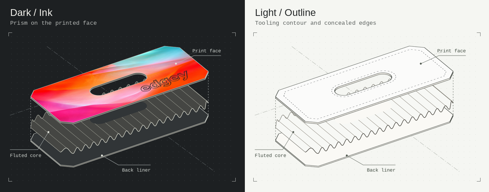
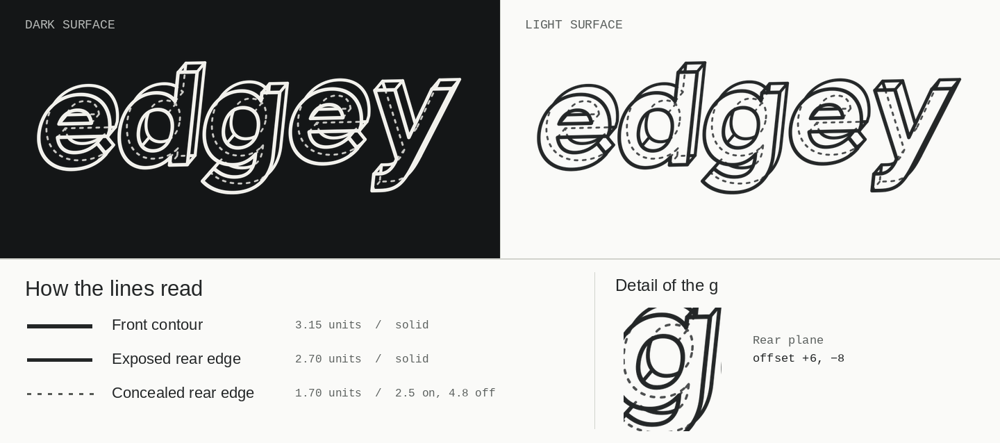
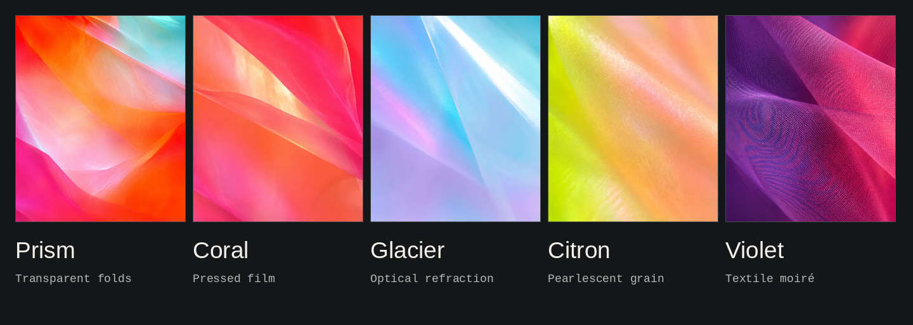
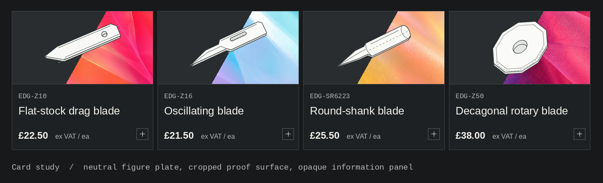

# Edgey UI design guide

**Approved storefront · Version 3 · 20 November 2026**

Edgey sells replacement tooling for digital cutting tables and plotters. The person on the print floor may know a part number, a machine or just the material on the bed. Give them a fast route into the catalogue. Let the printed surface of a single piece of corrugated board tell them whose shop they are in.

**The reference view opens in Dark / Ink / Prism.** A lowercase wire-drawn wordmark sits above a two-line heading. On the right, a printed face floats above its fluted core and back liner. The texture ends exactly at the edge of the cut and disappears inside the handle slot. That relationship between ink, edge and negative space is the most important visual detail to preserve.

[Open the approved live demo](https://edgey-blade-catalogue.agentatkins.chatgpt.site) · [Open the self-contained reference in the pack](Edgey-preview.html)



## Using this guide

Designers can start with the drawings and material proofs. Developers can jump to the token tables, component specifications and behaviour tests. A reviewer can open the reference beside a new build and use the last section as a visual walkthrough.

The measurements below describe the approved implementation. Values in pixels are CSS pixels unless identified as SVG units. The portable HTML embeds the artwork, CSS and interactions. Open it in a modern browser after extracting the ZIP. The four figures are artwork studies assembled from the source assets. Use the HTML for exact screen layout, focus behaviour and responsive sizing.

| In the handoff | Use it for |
| --- | --- |
| `design.md` | Design intent, exact values, interaction rules and review criteria. |
| `Edgey-preview.html` | A working visual reference with embedded assets. Resize the browser, change theme, change the print and open a product. |
| `design-tokens.json` | Reusable values for colour roles, type, proof names, responsive thresholds and characteristic angles. |
| `assets/` | The master wordmark, simplified favicon, editable board study, five proof textures, four catalogue drawings and four illustrative detail photographs. |
| `figures/` | Wordmark construction, paired drawing states, proof families and card composition. |

**Source fingerprint** · Published site version 3, commit `ef47b7acec4444c00049e6ad3ac5916a6b24b442`. The original implementation lives in `dist/index.html`, `dist/style.css`, `dist/app.js` and `dist/assets/`. The HTML contains the editable board paths. Prices and product references in the demo are illustrative.

### Contents

1. [Visual decisions](#visual-decisions)
2. [The wire wordmark](#the-wire-wordmark)
3. [Colour and surface](#colour-and-surface)
4. [The five print proofs](#the-five-print-proofs)
5. [Typography and language](#typography-and-language)
6. [Layout and responsive behaviour](#layout-and-responsive-behaviour)
7. [The material study](#the-material-study)
8. [Controls and interaction states](#controls-and-interaction-states)
9. [Catalogue, material index and footer](#catalogue-material-index-and-footer)
10. [Product details and selection](#product-details-and-selection)
11. [Accessibility and motion](#accessibility-and-motion)
12. [Extending and reviewing the design](#extending-and-reviewing-the-design)

## Visual decisions

| Element | Design decision | What to look for |
| --- | --- | --- |
| Page atmosphere | Use a near-black graphite desk on first visit. Offer a warm-white paper view with the same hierarchy. | The drawing remains a distinct surface in both modes. Separations read as ruled edges. |
| Colour | Place colour where a sheet could carry ink, reflect light or show a change of material. | Colour has a cut edge, a crop and an identifiable surface. Text and prices sit on neutral fields. |
| Engineering marks | Use a solid contour, dashed concealed edge, alignment axis or leader according to its purpose. | You can explain what every visible technical mark describes. |
| Controls | Give the main action a square profile and a narrow hatched end. Reserve the small plus for opening or finding something. | Labels remain instantly readable. Texture sits beside the label. |
| Workshop cues | Use the gridded cutting-mat idea as a dot field inside the drawing. Show packaging through the fluted core, liner and kraft swatch. | The page still feels like a modern specialist catalogue with the photographs hidden. |
| Hierarchy | Give the title room to breathe. Keep the catalogue immediately below the hero and the primary controls beside its heading on desktop. | A visitor can find a known blade without exploring the design exhibit. |

The most revealing comparison is to switch from Prism to Glacier, then to Outline. The object, spacing, labels and interface stay in register. Only its printed face and the information needed to see through it change.

## The wire wordmark



**Use the master SVG.** The five letters are custom paths. The two e forms share one master. The d has a tall ascender, the g is single-storey with a descending hook, and the y forks cleanly into a long descender. Together they read as a small object viewed in projection. The open counters let the colour of the surface show through. [Master wordmark](assets/edgey-wire.svg) · [Favicon](assets/favicon.svg)

| Construction | Approved value | Why it matters |
| --- | --- | --- |
| Artboard | `viewBox="0 0 400 141"` | Keep the original aspect ratio and internal breathing space. |
| Letter positions | x = 0, 73, 149, 225, 299 | The two e shapes occupy the first and fourth positions. Use the supplied spacing. |
| Front plane | 3.15 SVG units, solid | This is the strongest line. At header size it must carry the reading. |
| Exposed rear plane | 2.7 units, solid | The external offset establishes the depth. |
| Concealed rear plane | 1.7 units, dash 2.5 / gap 4.8, opacity 0.80 | Broken lines continue inside the silhouette wherever the front face conceals the rear edge. |
| Extrusion | Rear drawing translated +6 in x, −8 in y | Short connecting edges describe the same offset consistently across all five letters. |
| Final projection | `matrix(1 -.022 -.105 1 16 17)` | Gives the whole word its slight rise and lean. |
| Ink | `stroke="currentColor"`, round line caps and joins, open faces | The mark can take paper-white or graphite ink while the surface shows through it. |

The masks in `edgey-wire.svg` split the same rear geometry into exposed and concealed strokes. Preserve the masks when importing into a design tool. An outline-only font with a duplicate offset loses the change in visibility at the front face.

**Three placements establish scale.** The masthead uses the complete mark at `clamp(126px, 11vw, 166px)` on desktop. It steps down to 112, 88 and 72 px across the smaller breakpoints. On the board it sits inside the print clip, in the face’s own coordinates, at `translate(191 101) scale(.30)` with ink `#232227`. The footer is the large specimen at `clamp(205px, 28vw, 420px)` on pale print. Use this version to inspect the dash pattern. The favicon is an independently simplified e drawn for a small square.

**In implementation.** Make the home link’s accessible name “Edgey home” and hide its decorative SVG from assistive technology. Reuse the master through `#edgey` in an outer SVG with the same viewBox. This lets the header inherit the theme colour. A standalone image element needs an explicitly coloured master when its host cannot pass `currentColor` into the file.

## Colour and surface

The graphite theme uses several closely spaced neutral values. The catalogue, image plate, card body and drawing each have a specific surface. Substituting one generic black removes the depth that the borders are meant to describe.

| Role | Dark | Light |
| --- | --- | --- |
| Page / modal paper | `#141617` | `#FAFAF8` |
| Main text and inherited wordmark | `#F2F1EC` | `#232627` |
| Muted text token | `#B5B8B6` | `#5B605E` |
| Shared dividing rule | `#404549` | `#D1D3CD` |
| Utility panel | `#282C2E` | `#F2F3EF` |
| Catalogue section | `#17191B` | `#FDFDFB` |
| Product card body | `#1E2123` | `#FDFDFB` |
| Unprinted area on product card | `#292D30` | `#F0F2EE` |
| Search and tool-type fields | `#1E2123` | `#FAFBF8` |
| Material drawing plate | `#1D2022` | `#F5F6F2` |
| Drawing caption and proof strip | `#202325` | `#F9FAF7` |
| Primary action background / text | `#EEEEE8` / `#191B1C` | `#292C2B` / `#FFFFFF` |
| Focus ring | `#9BE3F9` | `#215DAD` |
| Footer surround | `#191B1C` | `#F1F3EE` |
| Muted full stop in hero heading | `#A5A9AA` | `#7A7F79` |

Light mode has local text adjustments. The intro uses `#555A57`, header navigation `#494C4A`, card codes `#636963` and card unit labels `#626761`. Dark mode uses the shared muted token for these. Focus uses its own cool colour. Text selection uses a pink ground, `#FFD0E3`, with `#302536` ink.

**Theme behaviour.** First visit starts dark. The button names the destination, reading “Light mode” with a sun in dark mode and “Dark mode” with a moon in light mode. Store the explicit preference under `edgey-theme`. Apply a saved light preference before the first paint and update the browser theme colour alongside the page. On compact headers the icon and accessible action name carry the switch. If storage is unavailable, theme changes still work for the current page.

## The five print proofs



Use the supplied WebPs for the approved finishes. Each contains a direction of light, a local interruption and a change in texture density. The pink-to-cyan transition in Prism, for example, bends with a film fold. A row of equally spaced colour stops would lose that physical cue.

| Visible name | Asset / source size | Surface character | Placement |
| --- | --- | --- | --- |
| **Prism** | `proof-prism.webp` · 1100 × 1100 | Translucent magenta and coral folds passing through amber, milky pink and cool cyan. | Initial hero print face and first swatch. |
| **Coral** | `proof-coral.webp` · 640 × 640 | Saturated red-pink pressed film with a pale warm crease. | Second swatch and flat-stock drag card. |
| **Glacier** | `proof-cyan.webp` · 640 × 640 | Ice-blue, cyan and lilac optical film with broad refractions. | Third swatch, oscillating card, vinyl index sample and right footer field. |
| **Citron** | `proof-lime.webp` · 640 × 640 | Lime into apricot and blush with visible pearlescent grain. | Fourth swatch, round-shank card and left footer field. |
| **Violet** | `proof-violet.webp` · 610 × 610 | Deep violet and raspberry, with a close textile moiré. | Fifth swatch, rotary card and textile index sample. |

Internal keys are `prism`, `coral`, `cyan`, `lime` and `violet`. Keep the customer-facing words **Glacier** and **Citron** even though their filenames use hue names.

**Crop by destination.** The hero maps its texture across a 342 × 170 local image area, then projects it with the board. Picker strips use a cover crop centred horizontally at 52% vertical. Product figures use a centre-cover crop inside a diagonal mask. The vinyl index crops Glacier at 60% / 50%. These are distinct crops of the same artwork, so the finish stays recognisable at different scales.

**Art direction for a future proof.** Begin with one physical surface such as a folded film, embossed sheet or weave. Pick one dominant hue, one related passage and a contrasting interruption. Put a recognisable surface event inside the centre crop and check it in the narrow picker strip. Keep lettering, logos, cast objects and UI labels out of the texture file. The wordmark belongs to the print layer, where it can be scaled or removed with the ink.

## Typography and language

The web layout uses a sans for reading and a mono for small amounts of technical information. Headlines are closely set and moderately weighted. The scale difference does most of the work. The production stack requests the following local families. An operating system may render a fallback, especially for intermediate font weights.

- **Sans** · `"Inter", "Helvetica Neue", Arial, sans-serif`.
- **Mono** · `"IBM Plex Mono", "SFMono-Regular", Consolas, "Liberation Mono", monospace`.
- **Wordmark** · the SVG supplies all letterforms independently of those stacks.

| Role | Size | Weight / leading / tracking |
| --- | --- | --- |
| Body | 16 px | Default regular, 1.5 line height. |
| Hero heading | `clamp(3.6rem, 6.55vw, 7.35rem)` | 480, 0.975, −0.068em. On compact layouts use `clamp(3.6rem, 11.5vw, 5.7rem)`. |
| Section heading | `clamp(2.05rem, 3.15vw, 3.35rem)` | 480, 1.07, −0.064em. Catalogue heading becomes 2rem on narrow phones. |
| Intro | `clamp(1rem, 1.23vw, 1.19rem)` | Regular, 1.55. Limit to 385 px on desktop, 39ch on compact layouts. |
| Product name | `clamp(1rem, 1.35vw, 1.35rem)` | Regular, 1.24, −0.035em. |
| Overline | 0.77rem | Mono, 450, 1.4, +0.064em, uppercase. |
| Product code | 0.76rem | Mono, +0.045em. Narrow phones use 0.70rem. |
| Primary action | 0.92rem | 520. |
| Search and filter text | 0.88rem | Sans. Placeholder and input remain legible on a neutral field. |
| Proof labels / count | Typically 0.75rem | Mono. Keep labels short and preserve the count’s singular or plural form. |

**The approved opening copy** uses “Digital cutter tooling” above “The cutting” / “room.” The break after *cutting* is deliberate. The full stop is part of the composition. The intro reads “Replacement blades for digital cutters and plotters. Find the right tool for your print floor.” Primary action “Find a blade”. Secondary action “Browse materials”.

Use UK English, sentence case for page headings, uppercase for small engineering labels where specified and mixed case for exact machine references. Use real workshop nouns such as blade, liner, flute, holder and substrate. Preserve compact price language such as “£22.50 ex VAT / ea”. Keep a description factual enough that a visitor can predict the action from its label.

## Layout and responsive behaviour

The page reads in work order. **Masthead → hero and material study → catalogue → material index → printed footer.** All sections share a frame. Only the ruled section boundaries and surrounding surface colours span the viewport.

| Area | Desktop construction |
| --- | --- |
| Frame | Width `min(100% − clamp(40px, 9vw, 160px), 1400px)`, centred. This subtraction is the **total** gutter. At 1440 px the content is about 1310 px wide with roughly 65 px per side. |
| Masthead | 74 px high with one bottom rule. Wordmark left, catalogue/material links next, mode and selection aligned right. Main group gap `clamp(22px, 4.2vw, 70px)`. |
| Hero | Two columns, 0.83fr / 1.17fr. Gap `clamp(30px, 5vw, 80px)`. Vertical padding `clamp(42px, 5.3vw, 83px)`. Centre the copy vertically against the full proof plate. |
| Heading block | Desktop h1 margin 26 px above and 20 px below, with a small −0.055em left optical adjustment. Actions begin 29 px below the intro. |
| Catalogue | Full-width surface and top/bottom rules. Heading left and search controls right. Four equal product columns separated by `clamp(12px, 1.3vw, 22px)`. |
| Materials | 0.88fr / 1.12fr. The heading sits on the left, the three fine-ruled substrate rows on the right. Desktop gap `clamp(38px, 8vw, 140px)`. |
| Footer | A contained wide print sample followed by a quiet credit row. Keep its frame aligned to the catalogue and masthead. |

| Viewport | Changes to preserve |
| --- | --- |
| From 1550 px | Add 8 px left optical padding to the hero copy. The shared frame caps at 1400 px. |
| 921 px and wider | Two-column hero, four catalogue cards and two-column material index. |
| 741–920 px | Frame subtracts 52 px total. Hero columns become 0.86fr / 1.14fr with 22 px gap. Product names reserve two text lines. Enlarge in-drawing annotations to 15 SVG units. |
| 491–740 px | Frame subtracts 38 px. Stack hero copy above the drawing. Masthead becomes 62 px, wordmark 112 px. Hide mode-button text. Stack catalogue heading above its controls, use two product columns, stack the material index. |
| 371–490 px | Same 38 px frame subtraction. Header 58 px, wordmark 88 px. “Blade catalogue” shortens to “Blades”. Selection becomes an icon with count. Replace diagram callouts with the three-part text key. Tighten the five proofs to a 4 px gap. |
| Up to 370 px | Frame subtracts 28 px. Wordmark 72 px. Reduce nav gaps, hatch width and card gaps. Hide the visible slash keycap and the card’s decorative plus. Retain the search shortcut and the whole-card action. |

At 390 and 320 px, the title, board and five selectable finishes remain visible in the same vertical sequence. Keep the five samples in one row. The mobile layer key reads “Print face / Fluted core / Back liner”. Labels below the drawing are easier to read than leader text scaled down with the art.

## The material study

[Open the editable board master](assets/corrugated-study.svg). It carries the original paths, masks, lettering and embedded Prism artwork in light-theme ink on a transparent background. The preview contains the full theme and state logic.

The hero is a sample of printed corrugated board with a handle slot. That everyday detail gives the colour a plausible substrate and gives the hidden-line view something worth revealing. The face, core and liner must share a cut contour and line up in the exploded view.

**Read the drawing from back to front.**

1. Draw the faint construction axes and vertical alignment guides.
2. Place the back liner and its thin exposed edge. The handle opening cuts through the liner.
3. Draw the corrugated medium above it. The ridge lines run into the same undulating front edge. Its slot mask follows the opening.
4. Add the thickness of the printed face and its paper surface. Clip the proof image and projected brand mark together to the face with an even-odd path so the opening remains clear.
5. Draw the outer contour and the leader lines. The three labels identify the print face, fluted core and back liner. Their text stays horizontal while the object is projected.

| Drawing feature | Exact reference |
| --- | --- |
| Geometry and presentation | SVG viewBox `0 0 620 411`. CSS drawing box uses `aspect-ratio: 620/370`, width 100%. Compact layouts cap the drawing height at 358 px. |
| Projection of print face | `matrix(1.18 -.40 .70 .58 48 167)`. Liner uses the same orientation with y translation 286. Its bottom edge is at 289. The core slot mask uses 245. |
| Printed skin | The face edge uses a y translation of 170.8. Keep this small thickness visible beneath the printed face. |
| Grid and corners | 17 × 17 px dot repeat, 0.65 px dot fading at 0.85 px. Corner ticks are 9 px with one-pixel rules. The grid belongs within the drawing field. |
| Visible contour | 1.15 SVG units, rounded joins. Dark stroke `#BBBFBA`. Light stroke `#454A44`. |
| Axes | 0.75 unit stroke with dash array `13 4 2 4`. |
| Alignment / concealed lines | 1 unit with dash array `3.5 4`. These marks align the lifted layers. |
| Leaders and labels | 0.9 unit leader, small filled endpoint, 13-unit mono label on wide screens. Title “Material study”, secondary label “Axonometric view”, caption “Printed corrugated board”. |
| Core tone | Dark fill `#454643`, ridge lines `#9C9E93`, front edge `#C5C7BC`. Light fill `#E9E6DE` and ridge lines `#858075`. |
| Outline mode | Hide the entire ink group, including the printed wordmark. Show the concealed inset lines. Outline-core fill becomes `#323739` in dark or `#F7F8F5` in light. |

**How the two controls work together**

| Starting point | Action | Expected result |
| --- | --- | --- |
| Fresh visit | Open the page | Prism is selected, Ink is pressed, all three layers are visible. |
| Ink, any proof | Choose Outline | Ink and the printed logo disappear. Dashed details become visible. The selected proof remains marked in the strip. |
| Outline | Choose Ink | Restore the same selected proof and its printed logo. |
| Either view | Choose a proof | Replace the image in the clipped face, press the matching sample, and show Ink. |
| Any view / proof | Toggle Light or Dark | Update paper, strokes, controls and type. Keep the current view and proof. |
| Any view / proof | Reload | Return the study to Ink / Prism. Restore the saved page theme independently. |

The view toggle has two adjoining square-edged buttons, each at least 44 px wide. The selected view is hatched. The five finish buttons each contain a real texture strip, a mono name and a selected square. Selection also changes the border. At phone width the square moves into the top-right of the swatch so it leaves the name clear.

## Controls and interaction states

| Control | Resting appearance | Feedback and behaviour |
| --- | --- | --- |
| Primary action | Square button, 1 px border, minimum height 44 px. Neutral high-contrast fill. The hero adds a 13 px plus before its label. | A 27 px hatched end cap expands to 31 px on hover in the desktop rule. Dark theme uses a light fill and dark hatching. The compact layout uses a 19 px resting cap. |
| Secondary link | Body-size sentence case with a fine underline and 5 px underline offset. | Makes the alternate route visible without competing with the primary button. |
| Theme / selection | Thin, square framed controls. A divider separates the selection count from its label. | Theme icon represents the destination. Count announces the number of blades. Compact header keeps action names accessible. |
| Search | 41 px field, thin border, 12 px drawn search icon, “Search blades” placeholder and a small `/` keycap where space permits. | Typing filters immediately. Use a 2 px focus ring. The hero action jumps to the catalogue and focuses the field. |
| Tool-type filter | Matching 41 px field and an inset 6 px chevron. | Native select with “All tool types”, “Drag”, “Oscillating”, “Rotary”. |
| Product card | The full card is a button. The small framed plus is a secondary cue. | Border strengthens, figure rises 2 px over 200 ms, plus tile gains hatching. Keep the text stationary. |
| Filter result | A compact result count and underlined “Clear filters” appear above the cards. | Announce the number of blades in a polite live region. A zero-result state offers “Show all blades”. |
| Pack choice | Three adjacent rectangular buttons, each at least 48 × 37 px with 5 px gaps. | Hatch the pressed option, update unit and total prices together. |
| Dialog close | 38 px square with a plainly drawn × at the upper-right. | Click, Escape and backdrop dismissal close the native dialog. Keep the body from scrolling while a dialog is open. |

**Hatching is directional and small.** In the light theme, the primary end cap uses a 127° repeating line with 3 px transparent and 1 px white at 24% opacity. In dark mode it uses the same pitch with `#5D6260` over the pale fill and a `#8D918F` divider. The dark theme’s pressed quantity/view tile has a slightly wider 5 px repeat over `#DDDEDA`. Use the solid part of a button for the action wording.

## Catalogue, material index and footer



### Catalogue cards

Build each card in three layers. First, place a neutral 1.94:1 figure plate. Second, clip the finish to the right-hand side. Finally, centre the complete line drawing with `object-fit: contain` above both surfaces. The angle runs below the object. The drawing stays continuous across it.

```css
.p-card-image::before {
  background: var(--proof) center / cover;
  clip-path: polygon(67% 0, 100% 0, 100% 100%, 38% 100%);
}
```

Use the full-width neutral text panel below a 1 px divider. Order the content as **part code → blade name → unit price and tax wording**. Align price and plus at the bottom even when one product name wraps. Standard panel padding is `16px clamp(12px, 1.2vw, 21px) 11px`. Narrow phones reduce it to 10 px.

| Card | Visible name | Line-art asset | Print finish |
| --- | --- | --- | --- |
| EDG-Z10 | Flat-stock drag blade | `drag-line.svg` | Coral |
| EDG-Z16 | Oscillating blade | `oscillating-line.svg` | Glacier |
| EDG-SR6223 | Round-shank blade | `cylinder-line.svg` | Citron |
| EDG-Z50 | Decagonal rotary blade | `rotary-line.svg` | Violet |

The card uses a drawing for quick silhouette recognition. Opening it gives the visitor a larger illustrative photo from the same asset family, such as `drag.webp`. These two views serve different distances. Keep the product background neutral in the detail dialog.

### Material index

The question “What are you cutting?” gives someone without a part number an entry into the same catalogue. On desktop the question breaks after “are”. On small screens it becomes a continuous heading. Each substrate row contains a swatch, a plain name and a right-aligned matching count in mono.

| Substrate | Visible treatment | Demo result |
| --- | --- | --- |
| Corrugated board | Warm kraft with repeated 110° flute marks. Keep this physical material cue in both themes. | EDG-Z16 and EDG-SR6223. |
| Vinyl | Cropped optical film from the Glacier proof. | EDG-Z10. |
| Textile | Raspberry/violet weave from the Violet proof. | EDG-Z50. |

Rows are at least 76 px tall on desktop and 65 px on narrow phones. Swatches are 48 px high and use `clamp(65px, 9vw, 143px)` for width. Selecting a row clears previous search and tool-type inputs, filters to the substrate, returns to the catalogue and focuses search. This is a browsing shortcut. A proof selection on the hero changes the artwork alone.

### Footer print sample

This is the widest use of colour and the clearest view of the lettering. Print the mark in `#202126` on the pale left field. The base is Glacier cropped at 50% / 54%. A Citron overlay cropped at 50% / 55% covers the left, ending at 74% of the top edge and 55% of the bottom edge. A pale warm tint on the overlay helps the dark lines stay distinct.

Keep the print sample aligned to the frame. Set its minimum height to `clamp(128px, 16vw, 220px)`, and place the wordmark with margins of 2% vertically and 6% horizontally. Underneath, the small credit “Demo catalogue · Illustrative UK trade pricing” and “Back to top” return the page to its neutral register.

## Product details and selection

Use the same surface language once the visitor opens a product. The dialog has square corners, a one-pixel border and a neutral background. Its width is the smaller of 510 px and the viewport width minus 30 px. Limit its height to 86dvh and allow internal scrolling when the content exceeds it. The dark backdrop is black at 66% opacity. The light backdrop uses `rgba(34,39,36,.45)`.

**Product detail reading order** · photograph, part code, product name, machine reference, compatible materials, pack quantity, total, per-unit price and full-width “Add to selection”. The photo panel scales from 120 to 175 px tall. Labels and values in the specification block use a two-column description list bounded by thin rules.

**Selection reading order** · part number, quantity × unit price, line total, “Remove”, subtotal ex VAT, a concise demo notice and “Continue browsing”. Adding an item opens this selection. Keep the demo notice visible where a user might otherwise expect an order to be submitted.

**Numerical fixture.** Open EDG-Z10 and select 5. Show **£99.75** as the total and **£19.95 each · ex VAT** beneath or alongside it. The selection row reads “5 × £19.95 = £99.75”. Pack thresholds are 1, 5 and 10 blades. The header count is the sum of units. On reload the demo retrieves valid quantities under `edgey-storefront-selection-v1`. A blocked storage API still allows a selection during the current page session.

## Accessibility and motion

- Use real links for destinations, buttons for actions, a labelled search input, a native select and named native dialogs. Provide a skip link to the catalogue as the first keyboard destination.
- The logo link announces the brand. The drawing exposes an image title and a short structural description. The card button announces its part number and full product name. A redundant product image inside that button can have empty alt text.
- Group the two drawing views separately from the five proofs. Expose the pressed state on each control. Keep visible names on the finishes and a square active indicator so colour alone never carries selection.
- Keyboard focus has a 2 px ring and typically 4 px offset. The search group has its own 1 px offset. Do a full keyboard pass from the header into and out of a product; confirm that focus remains visible after each close and filter update.
- `/` takes the visitor to catalogue search when focus is outside an editable element and both dialogs are closed. Normal typing in inputs, selects, textareas and editable content takes priority. Modified shortcuts pass through.
- The moving blade is a 2 px hover translation. With `prefers-reduced-motion: reduce`, remove transitions and use immediate scrolling. The proof and view selectors work without animation.
- **Measured colour pairs.** Main text / page is 16.05:1 in dark and 14.58:1 in light. Muted token / page is 9.07:1 and 6.13:1 respectively. These values cover the named flat-colour pairs. For new text over artwork, sample the actual crop at its lightest and darkest points.
- At small widths protect ordinary input and action text first. In the approved 320 px layout the visible keycap and decorative card plus drop away while the field, card and accessible names remain available. Check longer product names, enlarged browser text and a selection containing several items.

## Extending and reviewing the design

### Applying the system to another page

**A product family page.** Start with one part family or material question as the heading. Give one representative tool a large neutral figure plate. Borrow the catalogue diagonal for one proof crop. Keep part numbers, compatibility and pricing on an opaque panel. Carry over the search, buttons and detail-dialog patterns where their behaviour matches.

**A new material.** Choose a texture with a recognisable physical surface. Inspect the broad projected board face, the shallow picker strip and the small substrate thumbnail. Give it a short visible name and a stable asset key. If a saturated patch makes an on-object mark difficult to read, adjust the crop or the mark’s ink locally.

**A new illustration.** Start with the outer cut contour, then define its opening, exposed edge and hidden geometry. Add a leader only if it names a useful feature. Use the supplied board as the reference for stroke hierarchy and how texture passes behind a cut opening. Keep the tiny drawing labels out of phone layouts by providing an equivalent text key.

### Visual acceptance pass

| Compare | Expected observation |
| --- | --- |
| First paint on a fresh profile | Graphite theme, Ink pressed, Prism selected. The heading breaks into two lines. The full-colour face, darker core and separate liner are distinguishable at a glance. |
| Master lettering | Both e shapes match. On the large footer mark the rear edges change from solid to dashed as they pass behind the front. Header, board and footer all use the same letterforms. |
| Texture changes | Cycle all five proofs. Each changes the print face inside the same outline. The slot stays open, the printed logo stays registered and the rest of the catalogue holds its assigned colours. |
| Outline and return | Select Violet, choose Outline, then Ink. The violet face returns. From Outline, choosing Glacier immediately restores Ink with Glacier applied. |
| Theme comparison | Switch to Light. The card bodies, fields, drawing lines, hatched controls, caption and modal all change coherently. A reload keeps Light and returns the material study to Prism. |
| Search and filtering | Search for 3910301 and see one flat-stock drag blade. Clear, then choose Corrugated board and see two results. A query with no match exposes a usable route back. |
| Price and selection | Select a pack of 5 EDG-Z10. The detail and selection both show £99.75 ex VAT. Remove it and verify the empty state and header count. |
| Desktop frame | Compare at 1440 px. The board occupies the larger hero column, four cards share a row, and the footer proof aligns to the same left and right edges. |
| Phone frame | Compare at 390 and 320 px. The header controls fit, proof names remain distinct, the text key replaces leaders, cards remain two across, and the page has no horizontal scrolling. |
| Keyboard and motion | Reach the skip link, use search via slash, select a proof, open a product and dismiss with Escape. Inspect visible focus in both themes and the hover behaviour with reduced motion enabled. |

### Handoff to a designer or coding agent

> Build from the Edgey version 3 reference. Open the portable preview alongside the work. Reuse the master SVGs and five named proof textures. Start with the dark page, its fine rules, sentence-case type and square hatched controls. Put texture onto the object or inside a cut crop. Preserve the corrugated section, wire wordmark and material-led route into the catalogue. Compare the result in both themes, then at 390 and 320 px. Use the visual acceptance pass to record any deliberate departure from the approved design.

For subsequent revisions, attach the new version or commit to the changed guide entry. Where the change affects the artwork, replace the matching master and regenerate its reference plate. Keeping the mark, texture and working example together makes the revision possible to judge later.
